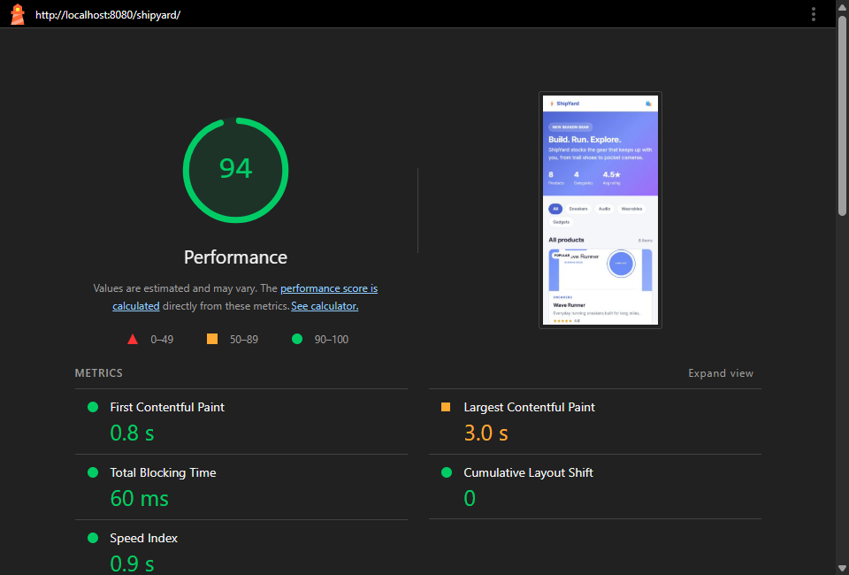

# ShipYard

A product-catalog storefront built with Next.js + TypeScript.

- **Live site**: https://jyothirodrigues2511-wq.github.io/shipyard/
- **Lighthouse Performance**: 94+ (mobile)



## Run locally

```bash
npm install
npm run dev
```

## What it does

Browse a product grid and open a detail page for each product. Optimized with `next/image`, `next/font`, dynamic lazy loading (`next/dynamic`), per-page metadata, and resilient loading, error, and not-found states.

## Architecture & Optimizations

- **Static Export**: Prerendered HTML pages via Next.js static export deployed to GitHub Pages.
- **Image Optimization**: Preloaded above-the-fold hero image with `priority`, responsive sizing via `fill` and `sizes` to eliminate layout shift (CLS: 0).
- **Self-Hosted Typography**: Zero render-blocking external font requests using `next/font/google` (`Inter`).
- **Code Splitting & Lazy-Loading**: Heavy below-the-fold customer `Reviews` component loaded on demand via `next/dynamic` with animated skeleton fallback.
- **Resilient Route States**: Built-in App Router handling with `app/loading.tsx`, `app/error.tsx` (with reset retry), and `app/not-found.tsx`.
